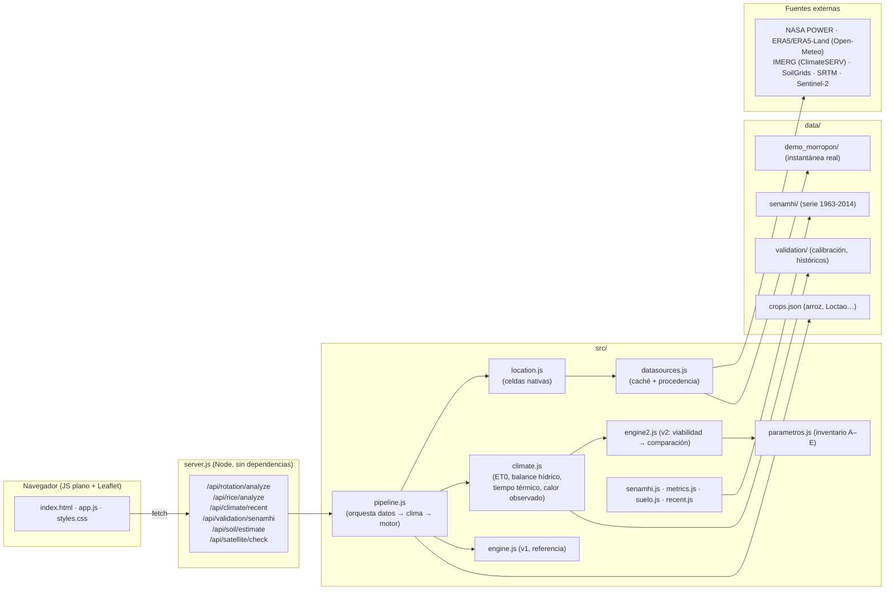
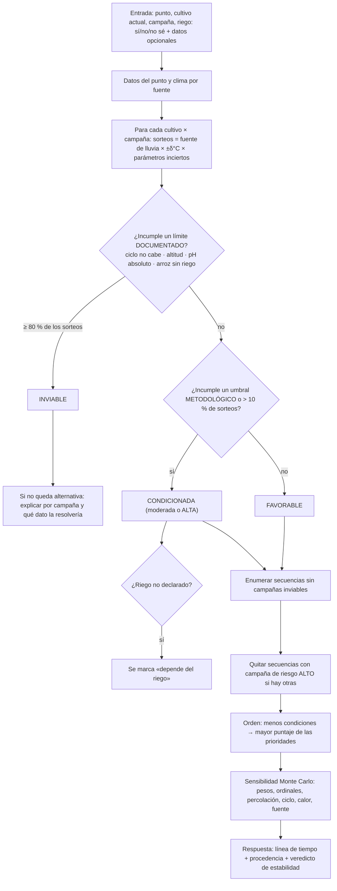

# Field Shift — Informe integral del MVP

Estado documentado: rama `feat/fieldshift-morropon-validation`, commit `7815113` (**antes** de incorporar el asistente Fieldi). Todo lo que sigue se verificó contra el historial de Git (48 commits en el repositorio), los archivos reales, los informes existentes y las pruebas (`npm test`: 116 pruebas, 0 fallos).

> Principio rector del proyecto: podemos trabajar con estimaciones científicas justificadas, pero nunca fabricar datos para completar el modelo ni presentar hipótesis como hechos. Este informe distingue lo que está **listo** de lo que es **experimental** o está **pendiente de validación**.

## 1. Resumen ejecutivo

Field Shift compara rotaciones de **arroz (Tinajones)** y **frijol Loctao** (*Vigna radiata*) en el valle de **Morropón (Alto Piura)**. A partir de la ubicación elegida en un mapa, reúne datos meteorológicos, satelitales y de suelo, comprueba **primero qué cultivos son viables en cada campaña** y **después compara** las secuencias de cuatro campañas (dos años), mostrando una línea de tiempo con fechas, agua necesaria, calor y la procedencia de cada dato.

Lo que el MVP hace hoy:
- Usa la **ubicación real** del usuario (antes el servidor consultaba siempre el centro del dominio).
- Corrige la temperatura con la **estación SENAMHI Morropón** (serie 1963–2014) y valida POWER, ERA5 e IMERG frente a ella (2001–2014).
- Evalúa viabilidad con **incertidumbre explícita** (fuentes de lluvia × temperatura × parámetros inciertos) y reserva «inviable» para límites documentados.
- Distingue **Instantánea** (sin formulario; escenarios y rangos) de **Precisa** (datos de la parcela en un modal).
- Rotula cada dato como **observado, bibliográfico, declarado, estimado o hipótesis**.

Lo que **no** hace: estimar rendimientos, ganancias ni salud del suelo por sí mismo; el margen económico solo se calcula con datos que declara el agricultor. No hay validación de campo ni de un agrónomo.

Tecnología real: servidor **Node.js sin dependencias** (`server.js`, `src/`), frontend **JavaScript plano** (`public/index.html`, `app.js`, `styles.css`) con Leaflet para el mapa. No se usa React, Vite ni Tailwind.

## 2. Historial por fases (Git)

| Fase | Fechas | Commits representativos | Resultado |
|---|---|---|---|
| v0.1–v0.2 genérico | 06–07 nov 2026 | `fb5d529`, `6e68244`, `8007034` | Pipeline NASA, motor de rotación (9 cultivos), tiempo térmico EcoCrop, auditorías, 44 pruebas |
| Demo Morropón | 14 nov | `9d8bf87`, `6500479`, `03e8ed8`, `a82400a`, `fcd16a8` | Dominio Morropón, arroz Tinajones + frijol común, modos Instantánea/Precisa, Sentinel-2, retroprueba con SENAMHI 2026 (65 pruebas) |
| Rediseño de interfaz | 14 nov | `ef72aaa` | Cabecera con pestañas, héroe, tarjetas, mosaicos |
| **Rama de validación** | 15 nov | `cd3f702` → `7815113` (20 commits) | Ubicación, SENAMHI, validación de fuentes, temperatura calibrada, Loctao, motor v2, auditoría de parámetros, interfaz v2 (116 pruebas) |

La rama parte de `ui-rediseno-fieldshift` (`ef72aaa`); `master` (`8007034`) y las demás ramas no se modificaron. No se ha hecho push.

## 3. Arquitectura general

Flujo de una recomendación: (1) el usuario marca el punto y completa lo mínimo; (2) `server.js` valida la entrada y rechaza lo que está fuera del ámbito sin consultar datos; (3) `pipeline.gatherData` resuelve las celdas nativas de cada fuente (`location.js`) y consulta/lee caché; (4) `buildClimates` construye una climatología por fuente de lluvia con la temperatura calibrada; (5) `engine2.run` evalúa viabilidad y compara; (6) la respuesta incluye `provenance`, `inputs_used`, `water_scenarios` y `engine_params`; (7) la interfaz dibuja la línea de tiempo y la sección «¿Cómo calculamos esta recomendación?».

## 4. Evolución del motor

| | v1 (original) | v2 / v2.1 (actual) |
|---|---|---|
| Estructura | Puntaje único sobre secuencias de 4 campañas; reglas eliminatorias | **Dos etapas**: viabilidad por cultivo × campaña × parcela, luego comparación |
| Cultivos del dominio | Arroz + frijol común (*Phaseolus vulgaris*) | **Arroz + frijol Loctao** (*Vigna radiata*); el frijol común queda en la base |
| Alternancia | Dominada por costo ordinal (+6,1 pts) y penalización de plagas (+4,3 pts); con solo criterios físicos ganaba el arroz continuo | Costo ordinal retirado del puntaje; sin doble conteo; prioridades repartidas entre criterios |
| Agua | Con riego, el criterio no veía la demanda | Demanda neta: ETc − lluvia (+ saturación 200 mm y percolación 2–8 mm/d para arroz, FAO) |
| Riego | Se asumía (`irrigation !== false`) | Tres estados: sí / no / **no lo sé** (escenario, marcado como condicionado) |
| Ubicación | Ignorada: datos del centro fijo | Datos de las celdas del punto; relieve y suelo del punto |
| Temperatura | POWER con corrección global (11 valores SENAMHI 2026) | ERA5-Land + offsets mensuales calibrados con SENAMHI 2001–2014 |
| Calor | Serie de reanálisis | Frecuencia **observada** en la estación (1981–2014) |
| Inviable | Umbrales mixtos | Solo por **límites documentados**; umbrales metodológicos dan «condicionada» |
| Sin alternativa | Devolvía solo la actual, sin explicar | `no_viable` con motivo por campaña y qué dato lo resolvería |
| Procedencia | Implícita | Categorías A–E en cada respuesta |

El motor v1 se conserva (`engine: 'v1'`) y una **prueba de regresión** fija sus resultados de referencia (centro, arroz–arroz, riego, inicio grande: 53,9 / 65,5 / 62,5; arroz–frijol, inicio chica: 65,5 / 59,9 / 59,9). Un laboratorio aislado (`../fieldshift-lab/`, fuera del repositorio) reprodujo exactamente esos puntajes antes de auditar el motor.

## 5. Corrección de la ubicación

Defecto hallado por el laboratorio: `server.js` llamaba `gatherData(rice.DOMAIN.center…)` en los endpoints de rotación y arroz, por lo que mover el marcador **no cambiaba nada**. Corrección: `src/location.js` resuelve para cada fuente la celda nativa que contiene al punto (POWER 0,5°×0,625°, ERA5 ≈0,1°, IMERG 0,1°) con **alias** a la estación de referencia para conservar la demo y las pruebas; elevación, pendiente y suelo se consultan en el punto exacto; fuera del recuadro no se consulta nada; si una fuente falla se declara el respaldo y **no** se sustituye por los datos del centro.

En seis puntos del recuadro cambian altitud (108–828 m), pendiente (0,2–61,5 %), pH, la lluvia disponible y la demanda de riego del arroz (1 067 → 1 242 mm en la campaña grande entre el centro y el suroeste). Con pendiente > 50 % el punto se declara «no recomendable». Entre los tres puntos aptos probados el ganador no cambia. Fuera del centro no hay serie IMERG descargada, por lo que se usa ERA5 con aviso.

## 6. Frijol Loctao

Evidencia: SENAMHI, Boletín agroclimático Piura 2024 (págs. 6–7): *Vigna radiata*, 900 ha en Morropón/Chulucanas; estación Morropón, emergencia 22-jul-2024 → «maduración» 14-sep-2024 (54 d). Nota de prensa 2025 (AgroPeru/Tridge): «75 a 90 días hasta grano seco», sin indicar desde cuándo se cuenta; 200 ha instaladas en el distrito de Morropón.

Parametrización (`data/crops.json`, cada parámetro con su procedencia): Kc y raíz (FAO-56), temperaturas y altitud (EcoCrop *V. radiata*), pH (EcoCrop vs. guía de Sudáfrica, en conflicto). **El ciclo (59 d) y el umbral de calor (35 °C) son hipótesis** y se propagan como rango (59/75/90 d; 32/35/38 °C). Se evalúa por condiciones en ambas campañas y se marca «sin evidencia local directa» en la grande.

## 7. Viabilidad y recomendaciones

Puntaje (0–100, relativo, **no es rendimiento**): demanda de agua, cobertura hídrica (solo con dotación declarada), calor, erosión, nitrógeno (ordinal), aptitud de suelo, rotación y —solo si el agricultor lo declara completo— margen económico o preferencia de mercado. Los criterios sin datos se omiten, no se rellenan. «Cultivo principal a conservar» (declarado) restringe las secuencias.

## 8. Tratamiento de la incertidumbre

- **Fuentes de lluvia**: IMERG, ERA5 y POWER son escenarios con pesos de confiabilidad (0,65 / 0,13 / 0,22) estimados con la validación 2001–2014; la clasificación se recalcula con pesos iguales y si cambia se muestra la más cautelosa.
- **Temperatura**: ±δ (≈ 1,9–2,4 °C) propagado como −δ, 0, +δ.
- **Parámetros hipotéticos**: ciclo y umbral de calor del Loctao, umbral de calor del arroz y percolación (rango FAO) se propagan como rango y se **muestran** como rangos en la interfaz (p. ej. «calor 1–70 %», «59–90 días»).
- **Riego no declarado**: dos escenarios rotulados como tales; lo que depende del riego queda «condicionado».
- **Sensibilidad Monte Carlo** (300 sorteos, semilla fija): pesos, ordinales, percolación/saturación, ciclo, umbral de calor y fuente. Veredictos: «claramente preferible», «probablemente», «equivalentes», «indistinguibles». Mide estabilidad, **no valida** agronomía.
- Cuando el resultado depende de datos no declarados o de supuestos con rango, la tarjeta lo marca «Resultado condicionado».

## 9. Fuentes de datos

| Fuente | Uso | Resolución | Estado |
|---|---|---|---|
| **SENAMHI Morropón** (estación, `qc00000235.txt`) | Observaciones diarias de lluvia, Tmax, Tmin 1963-10-01 → 2014-06-30; calibración y validación; frecuencia observada de días calurosos | puntual, diaria | 18 536 días; 95,9 % de lluvia válida; sin coordenadas ni altitud en el archivo; **no cubre 2015–2023** |
| **IMERG V07** (ClimateSERV) | Lluvia principal (2015–2023) | 0,1° | Solo el centro está descargado; otras celdas → ERA5 con aviso |
| **ERA5** (Open-Meteo, modelo `era5`) | Lluvia como escenario alternativo | ≈ 0,1–0,25° | Sobreestima (+135 % frente a SENAMHI) |
| **ERA5-Land** (Open-Meteo, modelo fijado) | Temperatura (con offsets mensuales) | ≈ 0,1° | Con `best_match` la API cambia de producto en 2017: se fijó el modelo |
| **NASA POWER** | Radiación, humedad, viento; lluvia como escenario; clima reciente (diario, casi tiempo real) | 0,5° × 0,625° | Subestima la lluvia (−46 %) |
| **SoilGrids 2.0** | pH, arcilla, arena en el punto | 250 m, modelado | Incertidumbre alta (p. ej. arcilla 1–60 % en el centro); es una estimación, no una medición |
| **SRTM** (OpenTopoData) | Altitud y pendiente | 30 m | Estimación; ventana de 180 m |
| **Sentinel-2** | NDVI del punto (verdor, no identifica especie) | 10 m | Informativo |
| OpenStreetMap | Mapa de fondo | — | — |

## 10. Validación meteorológica histórica (SENAMHI, 2001-01-01 → 2014-06-30)

Método: solo pares de fechas compatibles; partición temporal A = 2001–2007 y B = 2008–2014; cada corrección se calibra en un bloque y se valida en el otro, en ambos sentidos; línea base = climatología observada; bootstrap por años para la diferencia de errores. Informe: `docs/VALIDACION_FUENTES_SENAMHI.md`.

| Fuente de lluvia | Sesgo mensual | Error mensual (RMSE) | r (temporada ene–abr) |
|---|---|---|---|
| IMERG | +17 % | 49 mm | 0,97 |
| POWER | −46 % | 85 mm | 0,66 |
| ERA5 | +135 % | 109 mm | 0,87 |

IMERG es la mejor fuente, con intervalo bootstrap que excluye el cero frente a POWER y ERA5 (POWER vs ERA5: sin ganador confiable). No se aplicó corrección de sesgo a la lluvia (el factor global empeora; el mensual es inestable en la época seca). Con desfase de +1 día IMERG correlaciona mejor a escala diaria (0,40 → 0,59): diferencia de día de acumulación.

Temperatura: el sesgo de POWER cambia de signo con la estación (Tmax: −3,4 °C en diciembre, +2,2 en julio); una corrección global no sirve. Offsets mensuales sobre ERA5-Land mejoran el error fuera de muestra en ambos sentidos y superan a la climatología observada (Tmax 2,0 °C vs 2,3). **Los reanálisis corregidos subestiman 2–5 veces los días ≥ 35 °C** (estación: 522 de 4 897 días), por eso el estrés por calor usa la frecuencia observada.

Limitación central: **la serie termina en 2014**; se asume sesgo estable en 2015–2023 (hipótesis).

## 11. Instantánea vs Precisa

| | Instantánea | Precisa (modal «Datos de mi parcela») |
|---|---|---|
| Entrada mínima | Ubicación + cultivo actual (obligatorio, en rojo si falta) | Lo mismo + lo que quiera declarar |
| Riego | «No lo sé» por defecto → escenario con riego, marcado como condicionado | Sí / No / volumen m³/ha por campaña / percolación medida |
| Suelo | SoilGrids (estimación, con pista visible de textura y pH estimados) | Textura y pH medidos sustituyen la estimación |
| Fechas | Fechas de referencia de campaña | Fecha prevista de siembra de la 1.ª campaña; ciclo observado (arroz, Loctao); fechas observadas del arroz |
| Decisión | Sin cultivo principal ni economía | Cultivo principal a conservar; rendimiento, precio y costos (solo si están completos para ambos cultivos) |
| Valores vacíos | No declarados; nunca cero | Igual: vacío = no declarado |

Prueba aislada de 27 variantes (`docs/PRECISA_SENSIBILIDAD.md`): todos los campos cambian al menos un componente (viabilidad, demanda de agua, calor, duración, puntaje o ganador); dos sin cambios, justificados (economía incompleta no puntúa; «Loctao en ≥ 3 campañas» no es restrictiva si el ganador ya la cumple).

## 12. Parámetros (inventario auditado: 59)

| Categoría | Nº | Ejemplos |
|---|---|---|
| **A** Observado | 4 | Ciclo del arroz (SENAMHI 2026), frecuencia de calor observada, evidencia local del Loctao, período de lluvia |
| **B** Bibliográfico | 12 | Kc y raíz (FAO-56), EcoCrop, percolación 2–8 mm/d y saturación 200 mm (FAO), gradiente −6,5 °C/km |
| **C** Declarado | 13 | Riego, dotación, percolación, textura, pH, fecha de siembra, ciclo, cultivo principal, economía, prioridades |
| **D** Estimado | 6 | Pesos de fuentes de lluvia, temperatura calibrada, SoilGrids, SRTM, agua útil |
| **E** Hipótesis | 24 | Umbrales de calor, ciclo del Loctao, penalización por repetir, ordinales, umbrales metodológicos |

Detalle con fuente, método, incertidumbre y efecto: `docs/AUDITORIA_PARAMETROS.md`. Cada respuesta del motor incluye `provenance` con los datos realmente usados.

## 13. Cambios del frontend

- Cabecera con pestañas (Inicio, Recomendación, Indicadores, Aprende), logo Cropwise (imagen `Crop.png`) y menú hamburguesa en móvil.
- Héroe a todo el ancho con padding lateral, mascota Fieldi y globo; paisaje agrícola.
- Bloque 1: mapa Leaflet, área opcional, **cultivo actual obligatorio** (campos obligatorios y rangos inválidos en rojo con mensaje y foco).
- Bloque 2: selector Instantánea/Precisa, primera campaña (por defecto la próxima según la fecha), campaña anterior («No lo sé»), riego de tres estados; Precisa en **modal** con cinco secciones y resumen de datos indicados; pista de suelo de SoilGrids.
- Tarjetas de rotación con **línea de tiempo** (cultivo, campaña, fechas, duración, agua, calor, viabilidad, evidencia local, dependencia del riego), ilustraciones de arroz y Loctao, análisis detallado en modal.
- Sección «Conoce cómo interpretamos tu recomendación» y «¿Cómo calculamos esta recomendación?» (categorías A–E).
- Mosaicos: próxima campaña con justificación, clima reciente (NASA POWER, 7 días con dato válido y contraste con ERA5), NDVI.
- Pie sobrio con enlace a alcance y metodología. Diseño responsive revisado a 375, 430, 768, 1024, 1440 y 1920 px.

## 14. Comparación antes y después (centro, riego declarado; los puntajes de motores distintos no son comparables)

| Escenario | v1 original | v1 con temperatura calibrada | v2 |
|---|---|---|---|
| Grande, arroz–arroz | FAFA 65,5 / FFAF 62,5 | FAFA 65,1 / FFAF 62,6 | LLAL 61 / LALA 59,4 |
| Sin riego | sin alternativa | sin alternativa | sin alternativa recomendable (explicada) |
| 12 000 m³/ha | FAFA / FFAF | FAFA / FFAF | ALAL 64 / LALA 64,5 |
| 6 000 m³/ha | FAFA / FFAF (no ve el agua) | ídem | LLLL 56 (arroz con riesgo hídrico alto) |

(A = arroz, F = frijol común, L = Loctao.) Hallazgos: con la temperatura calibrada el frijol común no completa su ciclo en la campaña grande; el v1 no reaccionaba a prioridades, agua ni ubicación; el v2 sí (agua: 53–76 % de los escenarios cambian el ganador). Lo que más mueve el resultado es la percolación del arroz y el umbral de calor del Loctao. Detalle: `docs/COMPARACION_MOTORES.md`.

## 15. Pruebas ejecutadas

`npm test` → **116 pruebas, 0 fallos** (`node --test`). Cobertura por área: motor original y regresión (53,9 / 65,5 / 62,5), motor v2 (viabilidad, agua, percolación, sin riego, cultivo principal, economía, reproducibilidad), Precisa (no lo sé ≠ sí, vacíos ≠ cero, procedencia, fecha de siembra, textura, servidor), ubicación (celdas, alias, fallbacks), SENAMHI (formato, calidad, ausentes), clima reciente (ventana, estados, caché), inventario de parámetros, estimación de suelo, tiempo térmico, geografía e invariantes agronómicos. Scripts reproducibles: `senamhi_import`, `fetch_historic_sources`, `validate_sources_senamhi`, `comparar_motores`, `sensibilidad_precisa`, `auditar_parametros`.

Verificaciones manuales en navegador (Chrome headless): flujos de Instantánea y Precisa, validación en rojo, modales, ausencia de desbordamiento horizontal a 375/753/1009/1905 px.

## 16. Limitaciones científicas pendientes

1. La serie SENAMHI termina en 2014: la calibración de temperatura y los pesos de lluvia asumen sesgo estable en 2015–2023 (hipótesis).
2. Una sola estación de referencia; coordenadas y altitud de la estación no constan en el archivo.
3. Ciclo del Loctao (54–90 d) y umbral de calor (32–38 °C): sin fuente que los fije; falta la ficha de la variedad (INIA/DRAP).
4. Percolación del arroz sin medición local (decisiva con agua limitada).
5. Penalización por repetir cultivo y escalas ordinales (cobertura, biomasa, nitrógeno) sin cuantificar; riesgos fitosanitarios sin investigar.
6. Pendiente máxima del arroz inundado: desactivada por falta de fuente.
7. Sin término de producción: sin cultivo principal ni economía declarados, la comparación tiende al cultivo que menos agua necesita (la interfaz lo avisa).
8. IMERG solo descargado para el centro; el maíz y otros cultivos quedan fuera del MVP (investigación en el laboratorio).
9. No hay validación agronómica de campo ni revisión de un agrónomo.

## 17. Funcionalidades listas y experimentales

**Listas (probadas, con pruebas automatizadas):** ubicación real; importación y calidad de SENAMHI; validación de fuentes; temperatura calibrada; motor v2 con viabilidad, incertidumbre, procedencia y casos sin alternativa; Instantánea/Precisa con «no lo sé»; inventario de parámetros; clima reciente informativo; pista de suelo; interfaz v2.

**Experimentales / no activar como definitivas:** recomendaciones presentadas como validadas agronómicamente; la calibración aplicada a 2015–2023; umbrales de calor; percolación sin medición; pendiente máxima del arroz; corrección de sesgo de lluvia; maíz y terceros cultivos; clima reciente alimentando el puntaje. Ver `docs/MOTOR_V2.md` y `docs/CIERRE_MVP.md`.

## 18. Documentos de apoyo

`docs/MOTOR_V2.md` · `docs/CIERRE_MVP.md` · `docs/AUDITORIA_PARAMETROS.md` · `docs/PRECISA_SENSIBILIDAD.md` · `docs/COMPARACION_MOTORES.md` · `docs/VALIDACION_FUENTES_SENAMHI.md` · `docs/SENAMHI_MORROPON_QC.md` · `../fieldshift-lab/INFORME.md` (investigación previa, laboratorio aislado).
